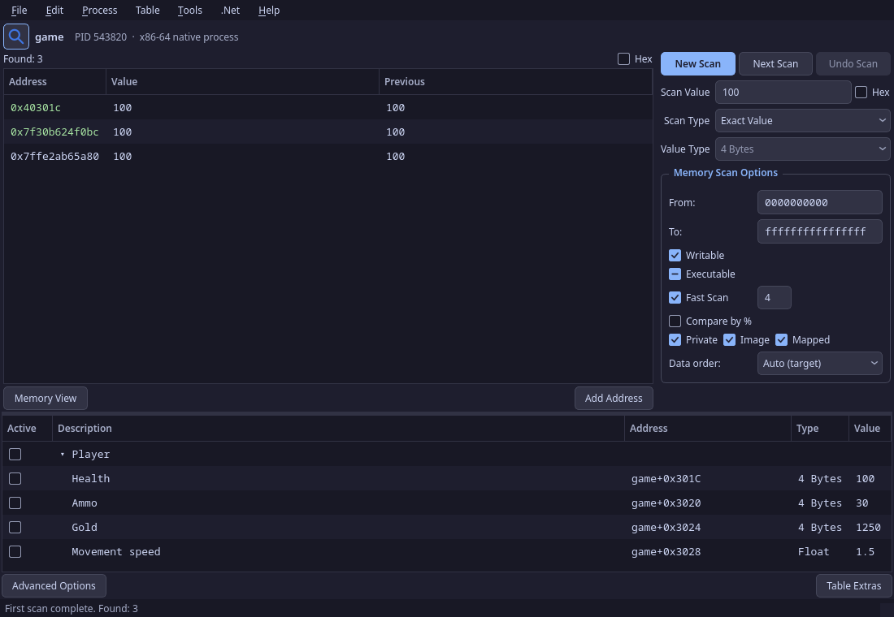

# Cheat Engine for Linux

A native Linux memory scanner, debugger, disassembler and trainer toolkit: a
from-scratch C++/Qt6 reimplementation of [Cheat Engine](https://github.com/cheat-engine/cheat-engine).
It talks to the kernel directly (`process_vm_readv`, `ptrace`, `/proc`) instead
of running the Windows build under Wine, and it opens your existing `.CT` tables.



> **Note.** This is an independent project and still growing: it doesn't cover
> everything Cheat Engine does yet. If something is missing or misbehaves,
> please [open an issue](../../issues).
>
> It is meant for single-player games, reverse engineering and learning. It is
> not designed to get past multiplayer anti-cheat (EAC, BattlEye, Vanguard and
> similar), which will detect it.

## Features

- **Scanning:** every value type, every Cheat Engine comparison, float rounding
  modes, region filters, multi-threaded disk-backed scans, undo, and pointer
  scans with rescan.
- **Editing:** typed writes, freezing (including increase or decrease only),
  hotkeys, groups, and records with pointer expressions such as `[[game+0x10]+8]`.
- **Debugger:** hardware and software breakpoints, conditional breakpoints in
  Lua, watchpoints, stepping, break-and-trace, and "find out what writes to
  this address".
- **Disassembler and Auto Assembler:** Capstone-backed disassembly with jump
  arrows, symbols and DWARF lines; Cheat Engine compatible scripts with
  injection templates.
- **Tables and Lua:** `.CT`, `.CETRAINER` and JSON tables, a broad Cheat Engine
  compatible Lua API, and generated standalone trainers.
- **Targets:** native Linux, Wine and Proton games, Mono/Unity (with a class
  dissector), emulators, and remote targets over ceserver or GDB/QEMU.
- **Fast:** a first scan of 1 GB takes about 0.09 s, roughly twice as fast as
  Cheat Engine 7.7 on Linux ([benchmark](BENCHMARK.md)).

## Install

Download the `.deb` or AppImage from the [latest release](../../releases/latest).
The `.deb` grants the permission to read other processes during installation.

To build from source:

```bash
sudo apt install build-essential cmake ninja-build qt6-base-dev zlib1g-dev \
                 libdw-dev libasound2-dev libsoundtouch-dev
cmake -B build -DCMAKE_BUILD_TYPE=Release
cmake --build build
cmake --install build --prefix ~/.local    # adds Cheat Engine to your app menu
```

Capstone and Keystone are downloaded and built automatically if your system
doesn't provide them. Reading another process needs ptrace permission; if a
target can't be read, the app explains why and offers to grant access.

## Usage

Start **Cheat Engine** from your app menu, or run `cheatengine`. Open a process
with **Ctrl+O**, enter a value, and press **First Scan**.

The `cescan` command-line tool does the same from a terminal:

```bash
cescan scan game --type i32 --value 100     # find a value
cescan write game 0x7f3a1000 999            # change it
cescan lua script.lua                       # run a Lua script
cescan --help                               # everything else
```

## Learn with the tutorials

Two games made to be changed come with the app (Help menu, or from a terminal):

- `cetutorial`: nine steps, from an exact value scan to pointers, code
  injection and code shared by players and enemies. Each step shows a password
  to come back to it.
- `cegtutorial`: three small game levels: a health bar, an overheating gun and
  a jump that is too low.

Both also run in a terminal with `--text`.

## AI agents

**Tools > AI Assistant** lets a model find and change values for you: bring
your own API key (Anthropic, OpenAI) or run a local model (Ollama, LM Studio).
The key stays in your system keyring, and every change to the game waits for
your Allow.

`cescan mcp` offers the same tools to Claude Code, Claude Desktop or any MCP
client:

```bash
claude mcp add cheat-engine -- cescan mcp --allow-writes
```

See [AI agents](docs/MCP.md).

## Documentation

- [Lua scripting reference](docs/SCRIPTING.md) and [examples](examples)
- [Supported targets and features](docs/COMPATIBILITY.md)
- [Changelog](CHANGELOG.md)
- [Contributing](CONTRIBUTING.md)

## License

MIT. Inspired by [Cheat Engine](https://github.com/cheat-engine/cheat-engine)
by Dark Byte.
